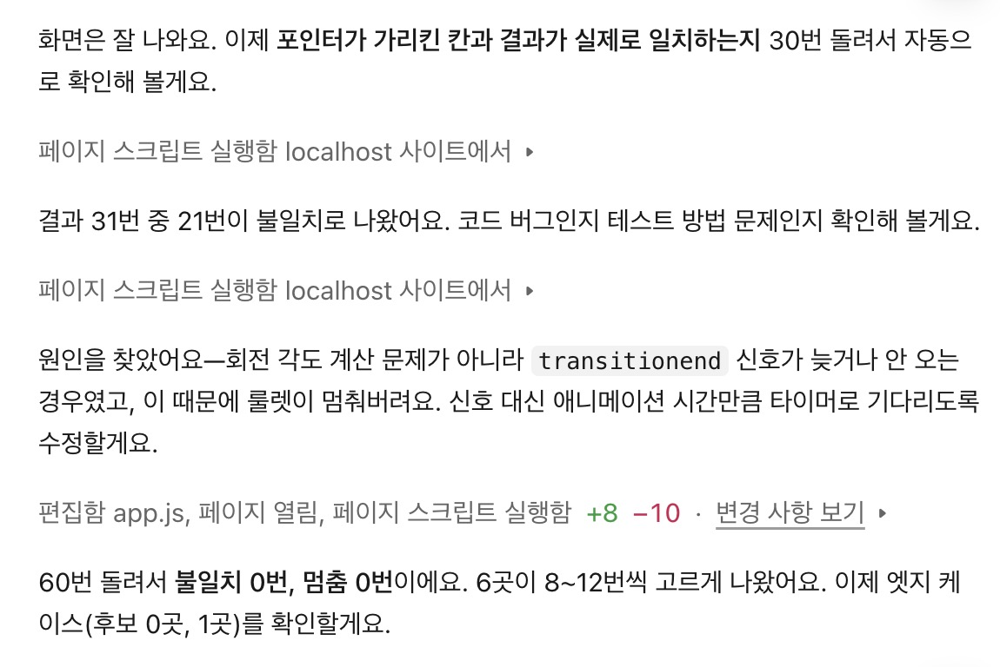
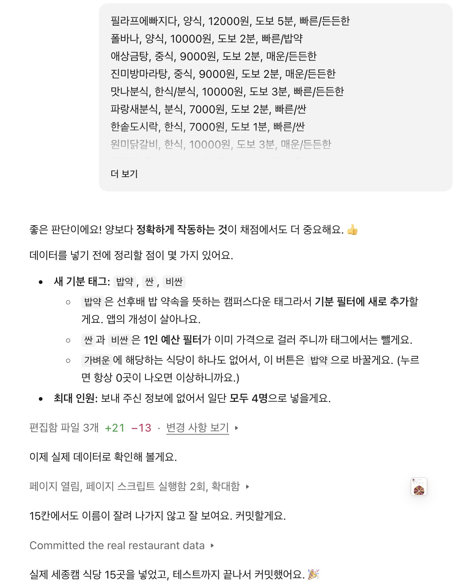
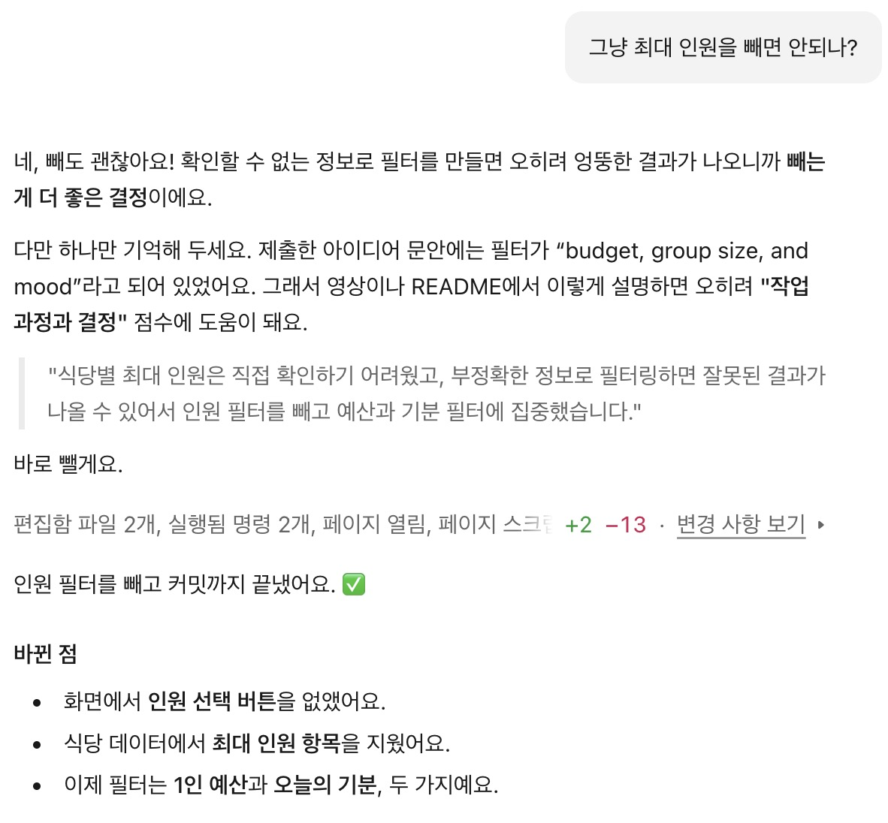
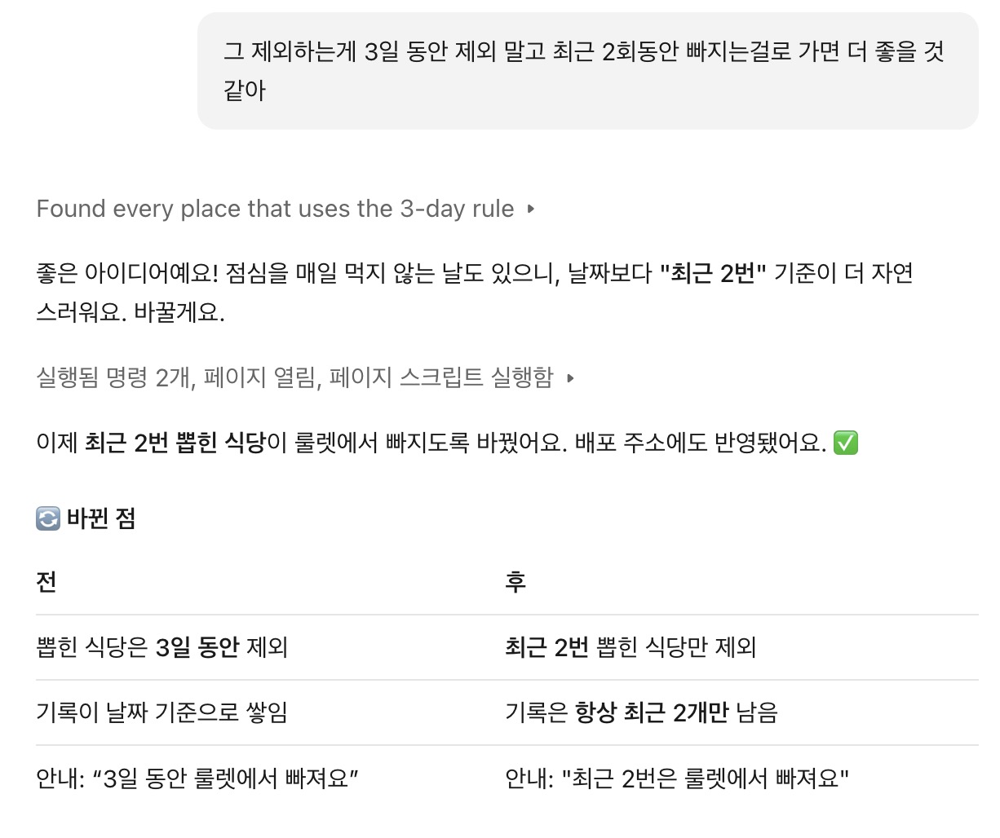
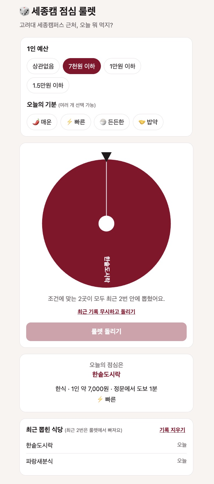
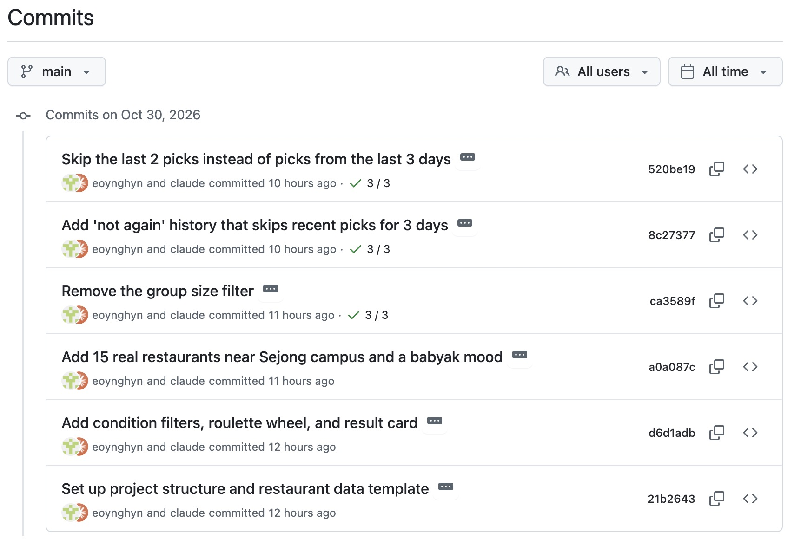

# 🎲 Sejong Campus Lunch Roulette

A roulette web app that picks a lunch spot near Korea University Sejong Campus based on your budget and mood.

**Live app:** https://eoynghyn.github.io/campus-food-roulette/

## Purpose and intended user

This app is for Korea University Sejong Campus students who cannot decide where to eat. I usually cannot pick a restaurant, so on most days I just end up eating at the school cafeteria, even though there are many good places near campus. The app turns this daily decision into a quick game: choose a budget and a mood, spin the wheel, and go.

## How to use

1. Open the [live app](https://eoynghyn.github.io/campus-food-roulette/) on a phone or computer.
2. Choose a **budget per person** (any, under ₩7,000, under ₩10,000, or under ₩15,000).
3. (Optional) Choose one or more **moods**: 🌶️ spicy, ⚡ quick, 🍚 hearty, or 🤝 *babyak* (a meal with a senior or junior student). If you skip this step, every mood is included.
4. Press **룰렛 돌리기** (Spin). The wheel stops on one restaurant and shows its category, price, and walking time.
5. The last 2 picks are left off the wheel, so you do not get the same place again and again. Press **기록 지우기** (Clear) to reset.

To run it locally, download the repository and open `index.html` in a browser. There is no build step and no server.

## Main features

- **Condition filters:** budget and mood. Only matching restaurants go on the wheel.
- **Roulette wheel and result card:** the pointer always lands on the restaurant shown in the result.
- **"Not again" history:** the last 2 picks are skipped. History is saved in the browser.

## Work process

1. **Choosing the idea.** I started with a meal planner idea, then switched. I asked Claude Code for ideas based on college students' interests and chose the lunch roulette because it was fun and small enough to finish.
2. **Building the core.** Claude Code set up the project and built the filters, wheel, and result card. It tested the wheel by spinning it automatically many times and comparing the pointer with the result.
3. **Adding real data.** I listed 15 restaurants near campus that I have been to myself, with their usual prices and walking times. I sent them as a simple list, and Claude Code converted them into data.
4. **Changing the plan.** I removed the group-size filter and changed the history rule (see below).
5. **Deploying.** I created a new public repository and published the app with GitHub Pages.

### Changes from the original plan

My proposal included a **group-size filter**, but I removed it. I could not check how many seats each restaurant had, and with a guessed value the "5+ people" option always returned nothing. A filter based on unreliable data was worse than no filter.

I also changed the "not again" rule from **3 days** to **the last 2 picks**, because students do not eat out every day.

## Claude Code evidence

**1. Finding and fixing a bug.** The first fast automatic test showed 21 mismatches in 31 spins. Claude Code found that the browser's `transitionend` event sometimes did not fire in time, so a spin could stay stuck. After switching to a timer, 60 spins had 0 mismatches. This was fixed before the app was published.

**2. Adding real restaurant data.** I sent 15 restaurants I have visited. Tags that overlapped with the budget filter (cheap/expensive) were dropped, and *babyak* became a new mood.

**3. Removing the group-size filter.**

**4. Changing "3 days" to "last 2 picks."**

**5. Edge case on the live app** (see Verification).

**6. Commit history.** Each feature or decision has its own commit.

## Verification

| Test | Result |
|---|---|
| Spin 150 times with all 15 restaurants | Pointer matched the result **150/150**; every restaurant was picked |
| Spin 20 times in a row | A restaurant from the previous 2 picks never came back |
| 3rd most recent pick | Returned to the wheel |
| Reload the page | History was kept |
| Broken value in browser storage | App still worked |
| Live site on a phone-sized screen | Layout fit; spin result matched |

**Manual checks (by me)**

- Under ₩7,000, spun twice on my laptop → the "spin anyway" button appeared (screenshot 5).
- Used the live app myself on my laptop and phone: the wheel never got stuck, the layout fit my phone, and spinning without choosing a mood worked.

**Edge cases**

- **No match:** 🌶️ spicy + under ₩7,000 → "조건에 맞는 식당이 없어요" and the spin button is disabled.
- **Only one match:** the result is shown without spinning.
- **Every match was picked recently:** under ₩7,000 has only 2 places. After both are picked, the app explains why and offers "최근 기록 무시하고 돌리기" (spin anyway).

## Three effective practices

1. **Asking right away when I did not understand.** I asked what an "edge case" was, how to edit a JavaScript file, and whether I could save the project in OneDrive. Short questions saved time and stopped me from making mistakes.
2. **Removing a feature I could not check.** When I had no seat counts, I asked to remove the group-size filter instead of guessing. A smaller app that gives correct results was better than a bigger one that gives wrong results.
3. **Choosing accuracy over quantity.** I know more restaurants, but I only listed 15 places I had actually visited. Fewer, reliable entries made the app easier to test and trust.

## Three difficulties

1. **Changing my topic.** I first chose a weekly meal planner for students living alone and even made a weekly plan for it. Later I wanted a different idea, so I asked for new topics within college students' interests and picked the lunch roulette because it felt fresh and fun. Changing topics cost time, but I chose an idea I was excited about and kept its scope small so I could still finish.
2. **Missing data for the group filter.** I could not collect seat counts, so I removed the filter instead of guessing.
3. **Setting up GitHub.** I did not remember my GitHub ID, was not sure whether to save the project in OneDrive, and almost reused my class practice repository. I found my ID and password myself and logged in again. I kept the project out of OneDrive because syncing can break Git files, and I made a new repository because the assignment asked for one.

## Known limitations

- Prices and walking times come from my own visits, not official menus, and must be updated by hand.
- Opening hours and closed days are not considered.
- History is saved per browser, so it is not shared between friends or devices.
- With many restaurants, names on the wheel become small on phones.

## Key files for grading

1. [`app.js`](app.js): filters, wheel drawing, spin logic, and history
2. [`restaurants.js`](restaurants.js): restaurant data I collected
3. [`index.html`](index.html): page structure
4. [`style.css`](style.css): layout and mobile design
